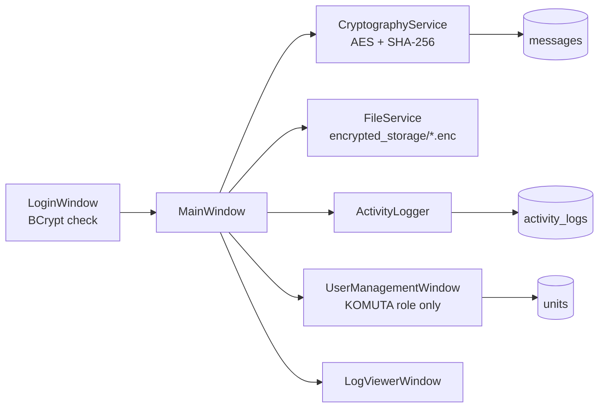

# AcsSecureSimulator

**English** · [Türkçe](README.tr.md)

A JavaFX desktop simulator of a secure messaging network between military-style units (command centre, ground control station, mobile unit, UAV): messages and files are encrypted with AES, verified with SHA-256, and every action is written to an audit log.

<!-- Demo GIF: log in as KKM → send an encrypted message → attach a file → open the log viewer -->

## Why

I built this as a technical case study for ACS Teknoloji. The goal was to model the basic building blocks of a secure communication system in one small, runnable application: authentication with roles, confidentiality, integrity checks and an audit trail, with a desktop UI an operator could actually use.

## Stack

- Java 21, JavaFX 21 (FXML), ControlsFX, Ikonli (Font Awesome 5)
- SQLite via `sqlite-jdbc`
- jBCrypt for password hashing
- `javax.crypto` (AES) and `MessageDigest` (SHA-256)
- Lombok, Maven (wrapper included)

## Architecture



| Layer | Classes | Responsibility |
|---|---|---|
| `view` | `LoginController`, `MainWindowController`, `UserManagementController`, `LogViewerController`, `MessageCellController` | FXML controllers |
| `service` | `CryptographyService`, `FileService`, `ActivityLogger` | Encryption, hashing, encrypted file storage, audit logging |
| `db` | `DatabaseManager`, `UnitRepository`, `MessageRepository`, `ActivityLogRepository` | SQLite schema, seed data, JDBC repositories |
| `model` | `Unit`, `Message`, `MessageStatus`, `ActivityLog` | Data classes |

**Flows**

- **Login.** Unit name + password, checked with BCrypt. The `KOMUTA` (command) role sees the admin menu; `OPERATOR` units do not.
- **Message.** The sender picks a receiving unit. The text is encrypted with AES and hashed with SHA-256; both are stored with sender, receiver, timestamp and status.
- **File.** The selected file is read as bytes, hashed, encrypted and written to `encrypted_storage/<uuid>.enc`. On download it is decrypted, re-hashed and compared with the stored hash before being saved. A mismatch is reported as an integrity failure.
- **Audit.** `MESSAGE_SENT`, `FILE_SENT`, `UNIT_ADDED`, `UNIT_DELETED` and `PASSWORD_RESET` are logged with unit name, IP address, hostname and timestamp, and can be browsed in the log viewer.
- **Unit management.** Command can add and delete units and reset passwords.

## Run it

Requires JDK 21.

```bash
./mvnw clean javafx:run
```

The SQLite database (`secure_messaging.db`) is created and seeded on first run. Demo accounts:

| Unit | Password | Role |
|---|---|---|
| KKM (command and control centre) | `Acs06` | KOMUTA |
| YKI_1 (ground control station) | `yki1_123` | OPERATOR |
| Mobil_Birim_3 | `mobil3_123` | OPERATOR |
| IHA_07 (UAV) | `iha7_123` | OPERATOR |

## Results

- A working end-to-end simulation: role-based login, encrypted text and file exchange, integrity verification on file download, and a searchable audit log.
- About 1,800 lines of Java across 4 layers and 5 FXML windows.

## Limitations

This is a simulator, not production cryptography. Known gaps, deliberately left as-is:

- One hard-coded AES key shared by all units. A real system would agree per-session keys (for example Diffie-Hellman / ECDH) and keep long-term keys in a keystore or HSM.
- `Cipher.getInstance("AES")` defaults to ECB mode without an IV. AES-GCM would give confidentiality and integrity in one step.
- The plaintext is stored next to the ciphertext in the `messages` table, and message text is included in the audit log, which defeats encryption at rest.
- SHA-256 without a key detects accidental corruption but not tampering by someone who can rewrite both the data and the hash; an HMAC or a signature would.
- All units share one local SQLite file; there is no network transport.

## What I learned

- Separating the crypto, storage, logging and UI layers made each security property (confidentiality, integrity, accountability) something I could point to in one class.
- Verifying integrity at the point of use (on download, after decryption) is more meaningful than storing a flag at send time.
- Writing down the limitations taught me as much as the implementation: key management, cipher modes and authenticated encryption are where real systems differ from a demo.
