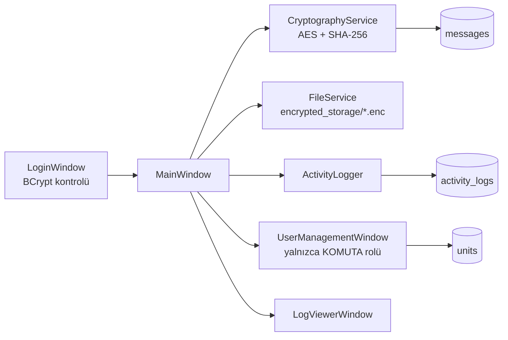

# AcsSecureSimulator

[English](README.md) · **Türkçe**

Askeri tarzda birimler (komuta kontrol merkezi, yer kontrol istasyonu, mobil birim, İHA) arasında güvenli mesajlaşmayı simüle eden bir JavaFX masaüstü uygulaması: mesajlar ve dosyalar AES ile şifrelenir, SHA-256 ile doğrulanır, her işlem denetim kaydına yazılır.

<!-- Demo GIF: KKM ile giriş → şifreli mesaj gönderme → dosya ekleme → log görüntüleyici -->

## Neden

Bu projeyi ACS Teknoloji için teknik bir vaka çalışması olarak geliştirdim. Amaç, güvenli bir haberleşme sisteminin temel yapı taşlarını küçük ve çalışan tek bir uygulamada modellemekti: rol tabanlı kimlik doğrulama, gizlilik, bütünlük kontrolü ve denetim izi; üstüne bir operatörün gerçekten kullanabileceği bir masaüstü arayüzü.

## Teknolojiler

- Java 21, JavaFX 21 (FXML), ControlsFX, Ikonli (Font Awesome 5)
- `sqlite-jdbc` ile SQLite
- Parola özetleme için jBCrypt
- `javax.crypto` (AES) ve `MessageDigest` (SHA-256)
- Lombok, Maven (wrapper dahil)

## Mimari



| Katman | Sınıflar | Görev |
|---|---|---|
| `view` | `LoginController`, `MainWindowController`, `UserManagementController`, `LogViewerController`, `MessageCellController` | FXML controller'ları |
| `service` | `CryptographyService`, `FileService`, `ActivityLogger` | Şifreleme, özetleme, şifreli dosya saklama, denetim kaydı |
| `db` | `DatabaseManager`, `UnitRepository`, `MessageRepository`, `ActivityLogRepository` | SQLite şeması, başlangıç verisi, JDBC repository'leri |
| `model` | `Unit`, `Message`, `MessageStatus`, `ActivityLog` | Veri sınıfları |

**Akışlar**

- **Giriş.** Birim adı + parola, BCrypt ile kontrol edilir. `KOMUTA` rolü yönetim menüsünü görür, `OPERATOR` birimleri görmez.
- **Mesaj.** Gönderen bir alıcı birim seçer. Metin AES ile şifrelenir ve SHA-256 ile özetlenir; ikisi de gönderen, alıcı, zaman damgası ve durumla birlikte saklanır.
- **Dosya.** Seçilen dosya byte olarak okunur, özetlenir, şifrelenir ve `encrypted_storage/<uuid>.enc` olarak yazılır. İndirirken şifresi çözülür, yeniden özetlenir ve kayıtlı özetle karşılaştırılır. Uyuşmazlık bütünlük hatası olarak bildirilir.
- **Denetim.** `MESSAGE_SENT`, `FILE_SENT`, `UNIT_ADDED`, `UNIT_DELETED` ve `PASSWORD_RESET` işlemleri birim adı, IP adresi, makine adı ve zamanla kaydedilir; log görüntüleyicide incelenebilir.
- **Birim yönetimi.** Komuta birim ekleyip silebilir ve parola sıfırlayabilir.

## Nasıl çalıştırılır

JDK 21 gerekir.

```bash
./mvnw clean javafx:run
```

SQLite veritabanı (`secure_messaging.db`) ilk çalıştırmada oluşturulur ve doldurulur. Demo hesapları:

| Birim | Parola | Rol |
|---|---|---|
| KKM (Komuta Kontrol Merkezi) | `Acs06` | KOMUTA |
| YKI_1 (Yer Kontrol İstasyonu) | `yki1_123` | OPERATOR |
| Mobil_Birim_3 | `mobil3_123` | OPERATOR |
| IHA_07 (İnsansız Hava Aracı) | `iha7_123` | OPERATOR |

## Sonuçlar

- Uçtan uca çalışan bir simülasyon: rol tabanlı giriş, şifreli metin ve dosya alışverişi, dosya indirirken bütünlük doğrulaması ve aranabilir denetim kaydı.
- 4 katman ve 5 FXML penceresinde yaklaşık 1.800 satır Java.

## Sınırlamalar

Bu bir simülatör, üretim seviyesinde kriptografi değil. Bilinen ve bilerek bırakılan eksikler:

- Tüm birimler tek bir sabit AES anahtarını paylaşıyor. Gerçek bir sistemde oturum anahtarları (ör. Diffie-Hellman / ECDH) ile üretilir, uzun ömürlü anahtarlar keystore veya HSM'de tutulur.
- `Cipher.getInstance("AES")` varsayılan olarak IV'siz ECB modunu kullanır. AES-GCM gizlilik ve bütünlüğü tek adımda sağlar.
- `messages` tablosunda şifreli metnin yanında düz metin de saklanıyor ve mesaj metni denetim kaydına da yazılıyor; bu, durağan veride şifrelemeyi anlamsız kılar.
- Anahtarsız SHA-256 kazara bozulmayı yakalar ama hem veriyi hem özeti değiştirebilen birinin müdahalesini yakalamaz; bunun için HMAC veya imza gerekir.
- Tüm birimler tek bir yerel SQLite dosyasını paylaşıyor; ağ üzerinden iletim yok.

## Öğrendiklerim

- Kriptografi, saklama, kayıt ve arayüz katmanlarını ayırmak, her güvenlik özelliğini (gizlilik, bütünlük, hesap verebilirlik) tek bir sınıfta gösterilebilir hale getirdi.
- Bütünlüğü kullanım anında (indirirken, şifre çözüldükten sonra) doğrulamak, gönderim anında bir bayrak saklamaktan daha anlamlı.
- Sınırlamaları yazmak en az uygulamanın kendisi kadar öğretici oldu: anahtar yönetimi, şifre modları ve kimlik doğrulamalı şifreleme, gerçek sistemlerin bir demodan ayrıldığı yerler.
